# Practice 1: Cloud Computing Services — Project Report

**Course:** Architectures and Infrastructures for Artificial Intelligence  
**Author:** Marius Botezatu  
**Date:** 18 October 2026  
**Repository:** <https://github.com/botezatumarius/azure-smart-lighting>

## 1. Introduction

A Smart Lighting System (SLS) switches street lights on and off depending on whether people
or vehicles are present in a control zone. Cameras are a common presence sensor: each frame is
analysed by an AI model and the resulting count drives the lighting controller.

This assignment builds that sensing pipeline and moves the AI processing step by step to the
cloud, to observe the advantages and costs of each model:

1. **Local processing:** capture and detect on a laptop.
2. **Azure virtual machine (IaaS):** the laptop captures, a cloud VM detects.
3. **Serverless (FaaS) with Azure AI:** uploads to Blob Storage trigger an Azure Function that
   calls the Azure AI Vision service.
4. **Multiple cameras:** find how many cameras each cloud architecture can handle.

All parts use the same people count (YOLOv8 or Azure AI) and record results in the same CSV
format, so the architectures can be compared directly.

## 2. Part 1: Local processing

### Task 1.1 — Webcam selection

The teaching team's sample camera (`http://83.56.31.69/mjpg/video.mjpg`) no longer responds,
so we picked a replacement that meets the requirements:

- **Camera:** official municipal webcam of the Gaggenau market square (Germany),
  <https://www.gaggenau.de/webcams.212.htm>.
- **Fixed:** the camera does not pan or zoom, so the control zone is always the same.
- **Scene:** a pedestrian square with shops, comparable to the promenade in the assignment.
- **Access:** a public JPEG endpoint (`https://www.gaggenau.de/webcam/image00001.jpg`),
  1280 × 720 pixels, which the city refreshes every 5 seconds. This matches Task 1.2's rate.

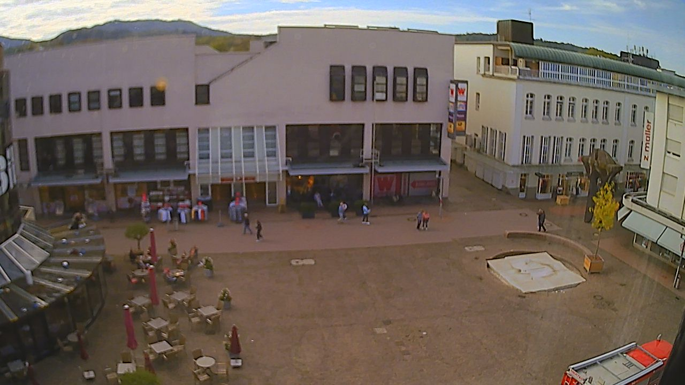

*Figure: a raw 1280 × 720 frame from the camera.*

### Task 1.2 — Capturing one frame every 5 seconds

`camera.read_frame()` uses OpenCV to open the camera URL, read one frame and close the
connection. `camera.capture()` calls it on a fixed schedule and yields timestamped frames; this
is the capture process that Parts 2 and 3 reuse. Design decisions:

- **A new connection for each frame.** A stream that stays open buffers frames while the
  model is busy, so the next frame read would be seconds old. Reconnecting always returns the
  current image. At one frame per 5 s this costs little (≈0.5 s per read in our tests).
- **One code path for every camera type.** OpenCV (through FFmpeg) reads JPEG snapshots, MJPEG
  streams and HLS streams, so other cameras can be added in Part 4 by adding a single URL.
- **Timeouts.** A camera that does not respond fails after 10 s instead of blocking the program.
  That frame is logged and skipped, and capture continues. We do **not** record a count of 0,
  because a camera failure is not the same as an empty street.
- **A fixed schedule.** Captures are planned at t = 0, 5, 10 … s on a monotonic clock. A naive
  `sleep(5)` after each frame would add the processing time to every interval and make the
  timing drift.

**Resolution.** The camera delivers 1280 × 720 frames. By default YOLOv8 shrinks every frame
to 640 px before detection. On this wide view a person is then only about 10 px tall, and most
are missed. We compared both sizes on the same frame, which had 8 people visible:

| Detection size | People found (of 8) | Run of 5 min: mean people per frame |
|---|---|---|
| 640 px (YOLO default) | 2 | 0.67 |
| **1280 px (native)** | **7** | **2.56** |

Detecting at the native 1280 px finds 3–4 times more people, so all parts use 1280 px. This
makes inference slower (≈400 ms instead of ≈160 ms per frame on the laptop), which is still far
below the 5-second interval. The camera's resolution is therefore sufficient, provided the model
is not given a smaller copy of it.

### Task 1.3 — Counting people with YOLOv8

`detector.PersonDetector` loads the pretrained **YOLOv8n** model (the smallest YOLOv8, suited to
CPU-only machines and later to a small VM). For each frame it:

1. runs YOLOv8 restricted to COCO class 0 (*person*) with confidence ≥ 0.5, the same threshold
   as the teaching team's sample;
2. counts the returned boxes;
3. returns the count, an image with the boxes drawn on it, and the inference time in ms.

The model is loaded once and warmed up with a blank image, so the first real frame's time is
not inflated by initialisation. The same class runs unchanged on the VM in Part 2.

`results.CsvLog` appends one row per frame to `counts.csv`, and `results.plot_counts` draws
the time-series graph:

```csv
timestamp,camera,people,inference_ms
2026-10-16T14:23:35+02:00,gaggenau,1,440.9
2026-10-16T14:23:40+02:00,gaggenau,0,399.4
2026-10-16T14:23:45+02:00,gaggenau,1,405.5
2026-10-16T14:23:49+02:00,gaggenau,2,353.5
2026-10-16T14:23:55+02:00,gaggenau,0,431.3
```

The timestamps include the UTC offset, so they remain unambiguous when compared with the cloud
VM (Part 2), which runs on UTC. The `camera` column lets the same file and graph hold several
cameras in Part 4.

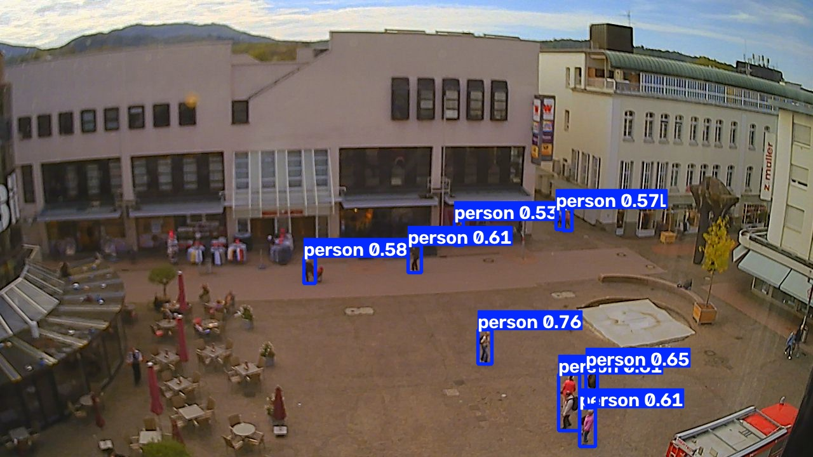

*Figure: a frame annotated by YOLOv8 (14:27:25, 9 people detected). Each box is one detected
person with its confidence. Two people are missed: one between the café tables, partly hidden,
and one at the right edge.*

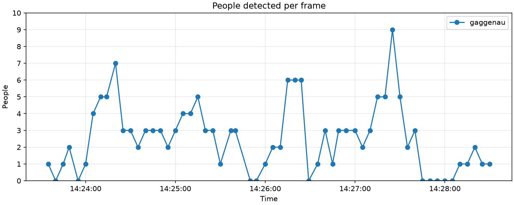

*Figure: people detected per frame, 16 October 2026, 14:23–14:28.*

**Results.** The run lasted 5 minutes and processed 59 frames (one camera read failed and was
skipped, as designed). The count varies from 0 to 9 people (mean 2.56). The graph shows people
crossing the square in waves, with peaks of 7, 6 and 9 people, and short empty periods (0) in
between. For the lighting controller these are exactly the moments to switch the lamps on and
off. Median inference time was 399 ms per frame on the laptop's CPU.

**Verification.** Automated tests (`pytest`) check the processing loop, skipping of failed
frames, the CSV format and the graph. They use a fake detector and camera, so they run in
seconds. We confirmed the detector on real footage with people (OpenCV's `vtest.avi`
pedestrian clip: 6 of 6 people found) and ran the full pipeline on the live camera.

### Problems encountered

| Problem | Solution |
|---|---|
| The sample camera from the teaching team is offline. | Picked an official, fixed municipal camera with a 5-second refresh. |
| At night the square is dark and empty, so every count was 0. | Recorded the evidence run during the day. |
| At YOLO's default 640 px most people were missed (2 of 8). | Detect at the camera's native 1280 px (7 of 8). |
| The sample code sleeps 0.5 s between frames and has no CSV header. | 5-second fixed schedule; CSV with a header. |

## 3. Part 2: Azure virtual machine

In this part the laptop only captures frames; detection moves to a VM in Azure
(Infrastructure as a Service: we rent the machine and manage everything on it).

```text
laptop: sender.py ──JPEG + token──▶ VM: vm.py ─┬─ YOLOv8 → counts.csv, annotated frames
                                               ├─ monitor.py → resources.csv (CPU, RAM, network)
                                               └─ dashboard: histogram, time series, latest frame
```

### Task 2.1 — Creating and configuring the VM

| Setting | Value | Reason |
|---|---|---|
| Size | **Standard_B2ats_v2**: 2 vCPU (AMD), 1 GiB RAM, burstable | The recommended B1s had no capacity in any region our subscription allows. B2ats_v2 is its current-generation successor, has the same 1 GiB of RAM, and is also free for students (750 h/month) |
| Image | Ubuntu Server 24.04 LTS | Long-term support; ships Python 3.12 |
| Region | Austria East | One of the five regions our student subscription may use, and the only one with capacity for a free-tier size |
| Inbound ports | 22 (SSH), 80 (HTTP) | Administration and the public dashboard |
| Authentication | SSH key, no password | Cannot be guessed by brute force |

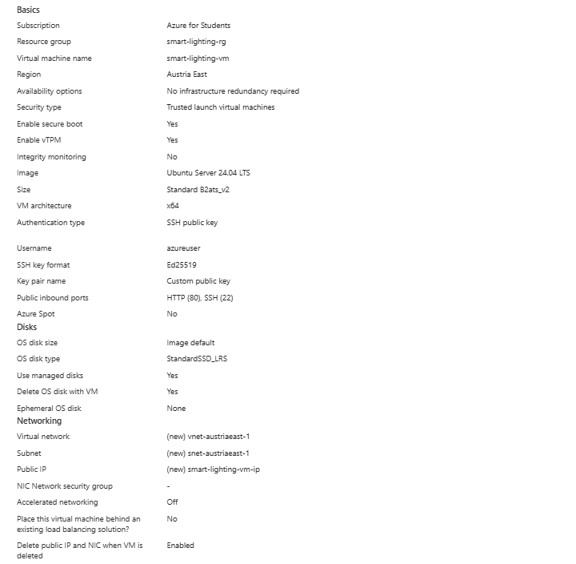

*Figure: the VM configuration at creation (Azure Portal, Review + create).*

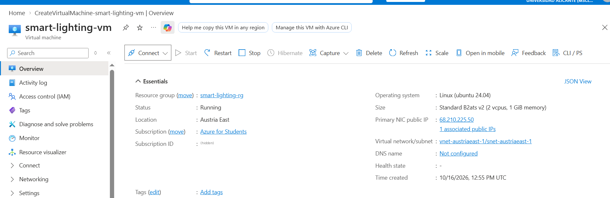

*Figure: the VM in the Azure Portal (size, image, public IP).*

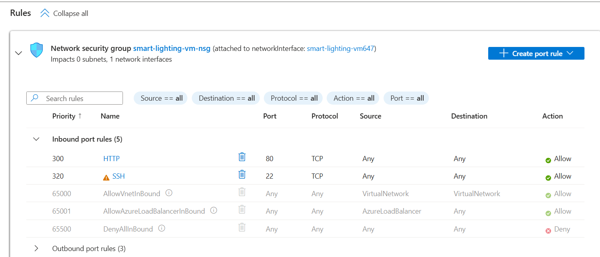

*Figure: inbound rules: only SSH (22) and HTTP (80) are open.*

The service running on the VM (`systemctl status smart-lighting; free -h` over SSH):

```text
● smart-lighting.service - Smart Lighting people counter and dashboard
     Loaded: loaded (/etc/systemd/system/smart-lighting.service; enabled; preset: enabled)
     Active: active (running) since Sat 2026-10-17 12:15:34 UTC; 10min ago
     Memory: 509.4M (peak: 614.0M swap: 266.2M swap peak: 266.2M)
     CGroup: /system.slice/smart-lighting.service
             └─673 /home/azureuser/smart-lighting/.venv/bin/python -m smart_lighting.vm --port 80

               total        used        free      shared  buff/cache   available
Mem:           842Mi       583Mi        82Mi       3.3Mi       318Mi       258Mi
Swap:          2.0Gi       330Mi       1.7Gi
```

`enabled` means it starts at boot: after the VM was stopped overnight and started again, the
service was running without any manual step. The memory lines confirm the 1 GiB limit
(842 MiB usable) and that part of the service lives in swap.

`deploy/setup.sh` makes the setup repeatable instead of a list of manual commands. It:

1. installs the required packages `python3-opencv` and `python3-pip` (plus `python3-venv`);
2. adds a 2 GiB swap file. With only 1 GiB of RAM, installing PyTorch and loading the model can
   exhaust memory, and Linux then kills the process (the "killed" error in the assignment's
   note 2). Swap lets the system move rarely used memory to disk;
3. installs the CPU-only build of PyTorch and the project in a virtual environment, with
   `--no-cache-dir` (assignment note 2). Ubuntu 24.04 does not allow `pip` to install
   system-wide, and a virtual environment keeps the project isolated;
4. creates a random upload token in `/etc/smart-lighting.env`, readable only by root;
5. installs a **systemd** service. The service starts at boot, restarts on failure, and runs as
   a normal user rather than root. It is still allowed to use port 80
   (`CAP_NET_BIND_SERVICE`).

### Problems encountered

| Problem | Solution |
|---|---|
| Creating the VM in West Europe failed with `RequestDisallowedByAzure`. | Azure for Students only allows five regions (listed under Policy → Assignments). We used France Central, the closest one. |
| Neither Standard_B1s nor Standard_B2ats_v2 was available in France Central, the closest allowed region. | B2ats_v2 was available in Austria East. It is B1s's current-generation successor, with the same 1 GiB of RAM, and is also free for students (750 h/month; list price $0.0108/h). |
| Another `ssh` (from an MSYS2 toolkit) came first on the laptop's PATH, so the key was created in the wrong place. | Moved the key to `%USERPROFILE%\.ssh` and called Windows' own OpenSSH explicitly. |

### Task 2.2 — Sending frames from the laptop

`sender.py` reuses the Task 1.2 capture loop (`camera.capture`). Each frame is compressed to
JPEG (quality 90, ≈170 kB for a 1280 × 720 daylight frame) and sent in an HTTP `POST /frames` request.
The VM answers with the people count. The sender logs each answer together with the
**round-trip time** and the **bytes sent**; these are the data for Task 2.5.

Design decisions:

- **HTTP with a JPEG body.** HTTP is simple and passes through firewalls, and the same request
  works for any number of cameras in Part 4. JPEG is about 16× smaller than the raw frame (2.7 MB).
- **Shared-secret token.** Port 80 is public because of the dashboard, so the upload endpoint
  requires an `X-API-Key` header. Without it, anyone on the internet could inject frames.
  (HTTPS would also encrypt the token; we left it out to keep the practice focused, since the
  frames come from a public camera.)

### Task 2.3 — Counting people on the VM

`vm.py` is a small **FastAPI** web service. For each uploaded frame it:

1. checks the token, and checks that the body is a valid image;
2. runs **the same `PersonDetector` as Part 1** (YOLOv8n, class *person*, confidence ≥ 0.5),
   so local and cloud results are directly comparable;
3. saves the annotated frame and appends a row to `counts.csv`, in the same format as Part 1.

The detector runs one frame at a time (a lock). PyTorch already spreads one inference over
both vCPUs, so running frames in parallel would not be faster and would need a second copy of
the working memory, which 1 GiB of RAM cannot afford. Extra frames wait in line, and that
waiting shows up in the response time. This is the effect we measure in Part 4.

The same frames seen from both sides. On the laptop, `sent.csv` holds the VM's answer plus
the round-trip time and upload size:

```csv
timestamp,camera,people,inference_ms,response_ms,bytes_sent
2026-10-16T15:03:05+02:00,gaggenau,2,549.7,1510.4,169480
2026-10-16T15:03:09+02:00,gaggenau,3,297.9,475.4,169692
2026-10-16T15:03:14+02:00,gaggenau,3,282.9,556.1,169651
2026-10-16T15:03:19+02:00,gaggenau,7,304.5,506.2,170648
```

On the VM, `counts.csv` holds the result of each frame (UTC, the VM's clock; 13:03 UTC is
15:03 in Spain):

```csv
timestamp,camera,people,inference_ms
2026-10-16T13:02:56+00:00,gaggenau,2,549.7
2026-10-16T13:03:00+00:00,gaggenau,3,297.9
2026-10-16T13:03:05+00:00,gaggenau,3,282.9
2026-10-16T13:03:10+00:00,gaggenau,7,304.5
```

### Task 2.4 — Results website

The same service serves a dashboard at `http://<public-ip>/`, refreshed every 5 seconds:

- a **histogram** of people per frame (how often 0, 1, 2 … people were seen);
- people over time, and the latest annotated frame;
- frames processed, mean people, mean inference time, and the VM's current CPU, memory and
  network use.

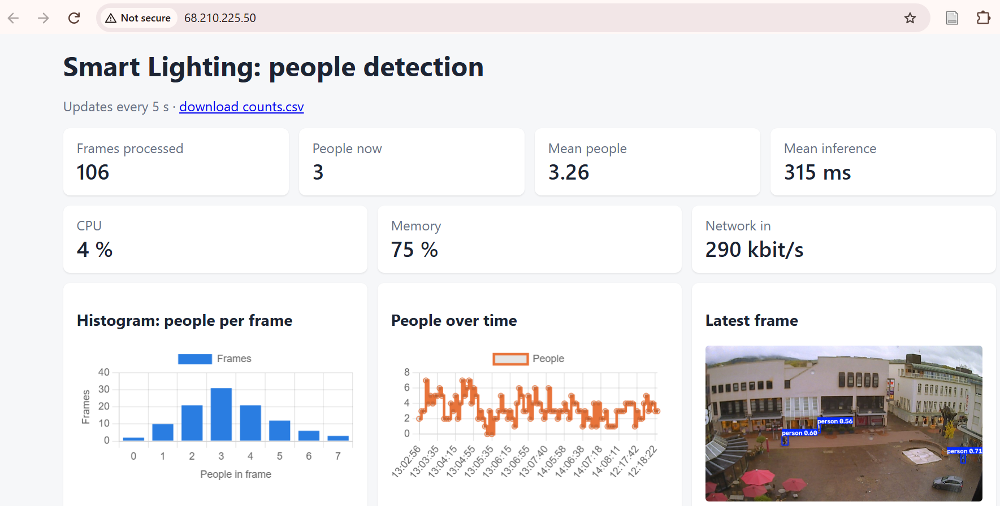

*Figure: the dashboard opened through the VM's public IP (`http://68.210.225.50/`). Top: frames
processed, current and mean people, mean inference time, and the VM's CPU, memory and incoming
network. Bottom: the histogram (most frames contain 2–4 people), the count over time, and the
latest frame with the detected people boxed. The time axis is in UTC, the VM's clock.*

### Task 2.5 — Performance

**Test conditions.** 16 October 2026, 15:03–15:08 (daylight). One camera (Gaggenau), one frame
every 5 s, 60 frames sent from the laptop (in Spain) to the VM in Austria
East. The VM ran only our service.

**How the data was obtained.**

| Metric | Source | Unit |
|---|---|---|
| Response time | `sent.csv` on the laptop: from sending the request to receiving the answer | ms |
| Inference time | `counts.csv` on the VM: YOLOv8 pre-processing + inference + post-processing | ms |
| CPU, memory, network | `resources.csv` on the VM: `psutil`, sampled every 5 s; cross-checked with Azure Monitor | %, MB, kbit/s |
| Bandwidth | size of each uploaded JPEG, logged by the sender | kB per frame, kbit/s |
| Cost | Azure price list for the resources used | USD |

**Results** (`python -m smart_lighting.analysis run`; lists are mean / median / 95th percentile):

| Metric | Value |
|---|---|
| Frames processed | 59 of 60 (one camera read failed and was skipped) |
| Response time (ms) | 621 / 520 / 1,231 |
| Inference time on the VM (ms) | 328 / 295 / 335 |
| Network + HTTP overhead (response − inference, median) | ≈ 225 ms |
| CPU usage of the VM (%) | 3 / 3 / 4 |
| VM memory in use (%) | 66 / 66 / 71 of 1 GiB (plus ≈ 140 MB in swap) |
| Memory of our service (MB) | 281 / 286 / 329 |
| Upload size | 170 kB per frame → 267 kbit/s |
| People per frame | mean 3.6, max 7 |

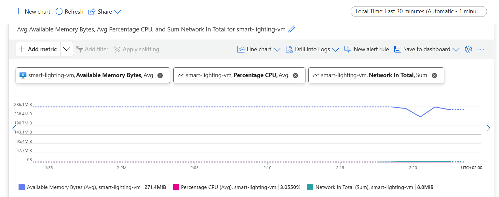

*Figure: Azure Monitor (the platform's own measurement, independent of our code) for the VM
with one camera: about 3 % CPU and 271 MiB of the 1 GiB still available, matching our
`resources.csv`.*

**What the metrics show.**

- **Response time.** A frame is answered in about half a second: ≈ 0.3 s of inference plus
  ≈ 0.2 s of network transfer (170 kB from Spain to Austria) and HTTP handling. That is far
  below the 5-second interval, so for a lighting controller the VM reacts in real time. The
  first frame was slower (1.5 s) because Linux had moved part of the idle model to swap;
  occasional peaks of 1–2.5 s have the same cause or come from the home connection.
- **CPU.** One inference uses about 0.3 s of one core every 5 s, so the 2-vCPU VM is about
  3 % busy. Almost all of its capacity is unused with one camera; Part 4 measures how many
  cameras it can take.
- **Memory is the real constraint.** The OS and the model leave little of the 1 GiB free, and
  some of it lives in swap. We added the swap file as a precaution, before installing PyTorch,
  so the "killed" error the assignment warns about never occurred.
- **Bandwidth.** 267 kbit/s upload per camera is small for a home or city connection. Data
  sent *into* Azure is free; only the dashboard's traffic leaves Azure.
- **Detection effectiveness.** The VM runs the same model with the same settings as Part 1,
  so it gives the same counts for the same image. Measured against a manual count on 12 frames
  it found **56 % of the people with no false detections**; the full comparison with Azure AI
  is in Task 3.6.

**Cost** (Azure list prices, Austria East):

| Item | Price | Note |
|---|---|---|
| VM Standard_B2ats_v2 | $0.0108 / hour | covered by the student free grant (750 h/month) |
| OS disk, Standard SSD 30 GiB | ≈ $2.40 / month | charged also while the VM is stopped |
| Public IP (Standard) | ≈ $0.005 / hour | charged also while the VM is stopped |
| Data into Azure | free | |
| **Total without the free grant** | **≈ $0.019 / hour ≈ $14 / month** | ≈ $0.000026 per frame at one camera |

With the free grant only the disk and the IP are paid: about $6 per month. The cost does not
depend on the number of frames, so it is the same for 1 camera or for the maximum the VM
can handle (Part 4). The VM costs money even when nobody walks by.

## 4. Part 3: Serverless and Azure AI

In this part there is no server to manage (Function as a Service). Uploading an image to Blob
Storage triggers a function, which asks the Azure AI Vision service to find the people in it.

```text
laptop: uploader.py ──JPEG──▶ Storage: raw/ ──Event Grid (raw/…/*.jpg)──▶ Function ProcessFrame
                                                                             │  ▲ people + boxes
                                                          Azure AI Vision ◀──┘  │
                                                                             ▼
                       browser ◀── static website ◀── Storage: $web/ (counts.csv, latest.jpg, frames/)
```

All Part 3 resources are in **France Central**: one of the five regions our subscription may
use, and one where the AI Vision *people* feature is offered. Keeping them in the same region
keeps the traffic between them fast and free.

### Task 3.1 — Static website in a storage account

We created the storage account `smartlightingmb` (Standard, LRS, the cheapest redundancy, which
is enough for a practice) and enabled **Static website** with `index.html` as index document.
Azure then creates the special `$web` container and serves it at a public URL,
<https://smartlightingmb.z28.web.core.windows.net/>.

`python -m smart_lighting.uploader --publish-website` uploads **the same dashboard as Part 2**
(`index.html`, `dashboard.js`) and creates `counts.csv` with its header. The dashboard only
reads `counts.csv` and `latest.jpg` from its own folder, so it runs unchanged on both
architectures. It hides the VM resource cards when there is no VM.

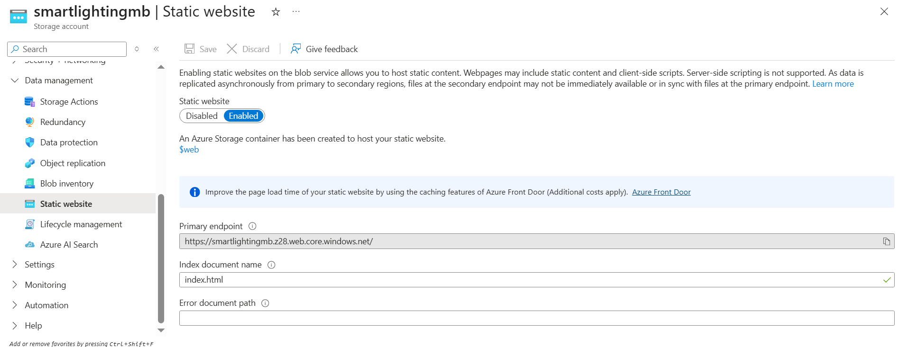

*Figure: static website enabled on the storage account, with its public endpoint.*

### Task 3.2 — Uploading images to a separate container

The account has two containers: **`$web`** (the website) and **`raw`** (incoming frames, private).

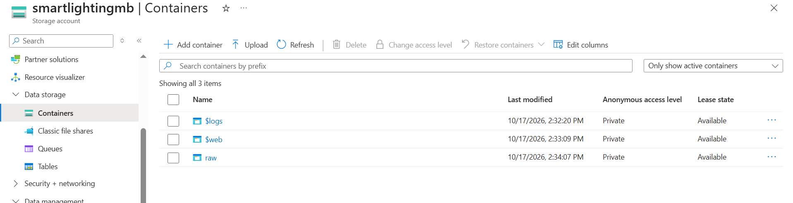

*Figure: the `$web` and `raw` containers, both private (`$logs` is created by Azure).*

`uploader.py` reuses the Task 1.2 capture loop and the Part 2 streaming code; only the target
differs (`BlobTarget` instead of `VmTarget`). Each frame is stored as
`raw/<camera>/<UTC capture time>.jpg`, at one frame every **0.5 s**, as the assignment suggests.
The name carries the camera and the capture time, so the function needs no extra metadata.
The Gaggenau camera refreshes every 5 s, so about 9 of every 10 uploads repeat the previous
image. We kept the requested rate because it doubles as a small load test; Part 4 uses the
realistic 5 s.

The laptop authenticates with the storage account's connection string, read from an
environment variable (kept in a git-ignored `.env` file), never from the code.

### Task 3.3 — Function with a blob trigger on the input container only

The function app `smart-lighting-func-mb` uses the **Flex Consumption** plan (Linux,
Python 3.12, 2,048 MB instances). It is billed only while it runs and scales out automatically.
Following the teaching team's Blob Trigger guide, the trigger is **event-based**
(`source="EventGrid"`): Storage publishes an event when a blob is created, and an Event Grid
subscription delivers it to the function. This reacts within about a second, without the
polling of a classic blob trigger.

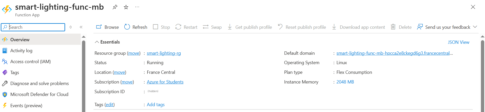

*Figure: the Function App (Flex Consumption, France Central).*

**Avoiding recursion.** The function writes into the same storage account it is triggered
from, so a wrong configuration could make it trigger itself in a costly loop (the assignment's
warning). Three independent safeguards prevent this:

1. the code's trigger path is `raw/{name}`: only blobs in `raw` are bound to the function;
2. the Event Grid subscription only forwards *Blob Created* events whose subject begins with
   `/blobServices/default/containers/raw/blobs/` and ends with `.jpg`;
3. the function only writes into `$web`, which neither of the above matches.

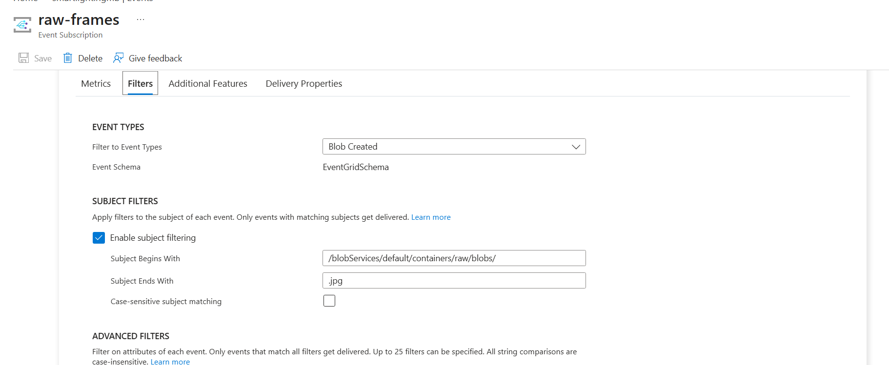

*Figure: the Event Grid subscription's filters: Blob Created events in `raw`, `.jpg` only.*

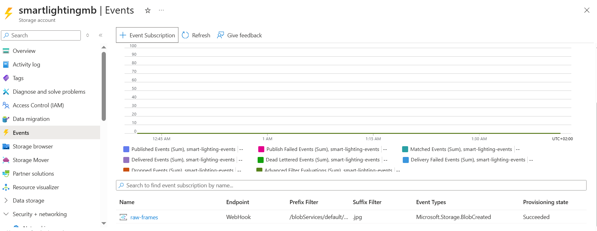

*Figure: the event subscription `raw-frames`, delivering to the function's webhook.*

**Identities instead of keys.** The function reads and writes the data account with its
**system-assigned managed identity**, which was given *Storage Blob Data Owner* and *Storage
Queue Data Contributor* on `smartlightingmb`. The app settings contain only the account's
address (`DataStorage__blobServiceUri`, `__queueServiceUri`, `__credential=managedidentity`);
there is no storage key in the code or in the settings. The function's own internal storage
uses a separate user-assigned identity created by the portal.

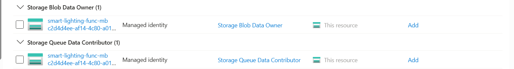

*Figure: role assignments of the function's managed identity on the data account.*

The code was deployed from VS Code (*Azure Functions: Deploy to Function App*), as in the
teaching team's guide.

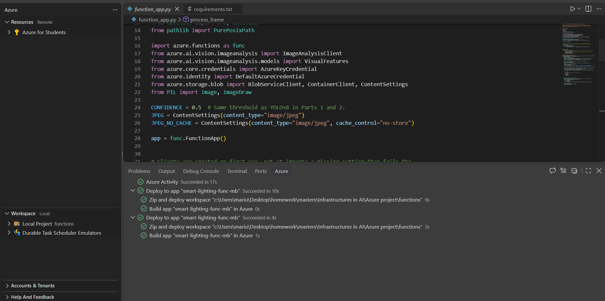

*Figure: deployments from VS Code.*

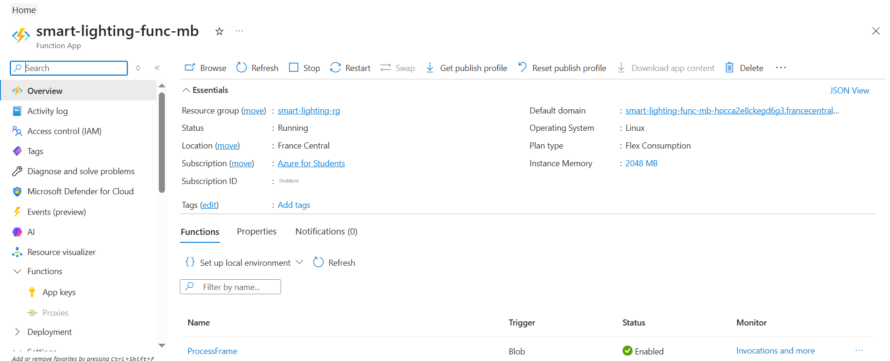

*Figure: the deployed function `ProcessFrame` with its blob trigger.*

### Task 3.4 — Azure AI Vision service

We created a **Computer Vision** resource `smart-lighting-vision-mb` in France Central with the
**Standard S1** tier. The free F0 tier allows only 20 images per minute, a tenth of what
one camera at 0.5 s sends. Its endpoint and key are stored as app settings of the function
(`VISION_ENDPOINT`, `VISION_KEY`), not in the code. The teaching team's guide suggests Azure
Key Vault for production; app settings are encrypted at rest and enough for this practice.


*Figure: the Computer Vision resource (S1, France Central).*

### Task 3.5 — Counting people and drawing their boxes

For each new frame, `ProcessFrame` (`functions/function_app.py`):

1. reads the image from the trigger;
2. calls Image Analysis 4.0 with the **`PEOPLE`** feature. The image *tagging* feature named in
   the assignment only says *whether* there are people, not how many or where, while
   `PEOPLE` returns one entry per person with a confidence and a `bounding_box`. As in
   Parts 1 and 2, people with confidence ≤ 0.5 are discarded;
3. draws a rectangle around each person from its `bounding_box` (Pillow);
4. stores the annotated image as `$web/frames/<camera>/<name>.jpg` and `$web/latest.jpg`;
5. appends a row to `$web/counts.csv`: capture time, camera, people, AI Vision time and latency.

`counts.csv` is an **append blob**: many function instances may finish at the same time, and
each append is atomic, so rows are never lost or mixed. A normal blob would need a
read-modify-write that loses rows under concurrency.

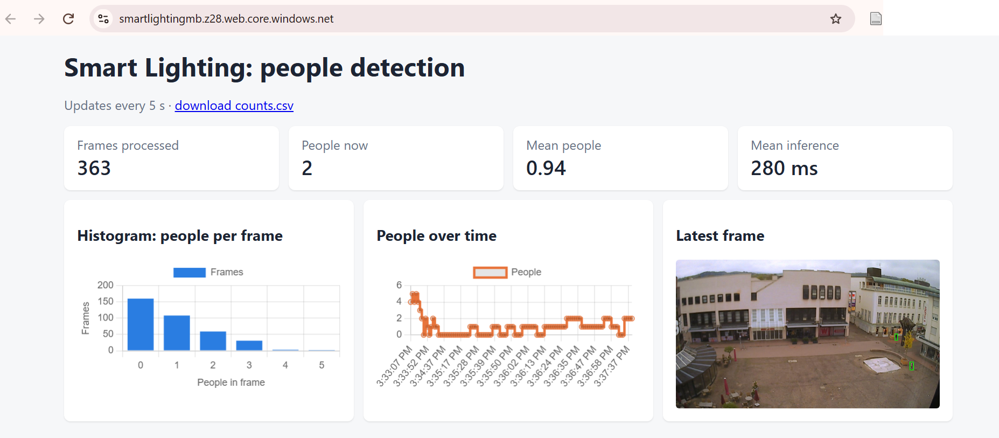

*Figure: the static website showing the serverless results: histogram, people over time and
the latest frame with the people boxed by the function.*

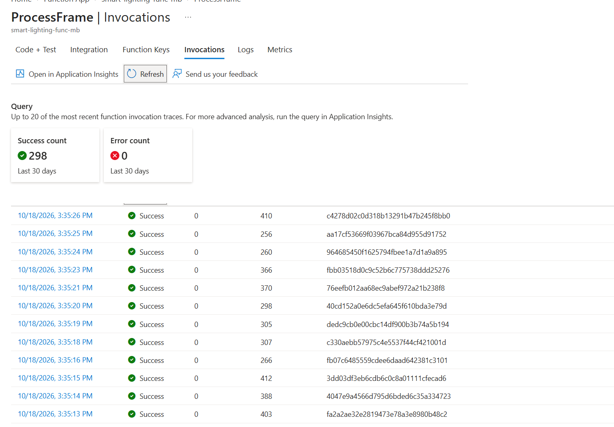

*Figure: invocations of `ProcessFrame`: all successful, each taking 0.25–0.41 s.*

### Problems encountered

| Problem | Cause and solution |
|---|---|
| After the first deployment the function did not appear in the portal. | The code read its settings when the module was imported, and they were not set yet, so Python failed to load the file. The clients are now created on first use: a missing setting now fails one invocation with a clear message instead of hiding the function. |
| Event Grid delivered nothing ("Delivery Failed" in its metrics); the app returned HTTP 503. | The portal gave the app's internal identity only blob rights on its internal storage, but the event-based blob trigger also uses queues there: 881 × `403 AuthorizationPermissionMismatch`, and the host kept restarting. We added *Storage Queue Data Contributor* and *Contributor* (the narrower *Storage Account Contributor* would be the least-privilege choice), then stopped and started the app. |
| After the fix, deliveries returned HTTP 401. | During the crash loop the host had generated new system keys, so the webhook URL in the Event Grid subscription contained an outdated `blobs_extension` key. We updated the endpoint with the new key. |
| About 5 % of frames at 5 s, and far more at 0.5 s, came out partly grey. | The camera rewrites its image every 5 s, and a download overlapping the rewrite returned a truncated file, which OpenCV decoded without any error. We found it while checking frames by eye, confirmed it (3 of 30 downloads), and now verify that each downloaded JPEG ends with its end marker `FF D9`; incomplete images are skipped like any failed read. Timing measurements are unaffected; people counts in the affected frames (3 of 59 in Part 1) may be too low. |
| Measured latencies were negative (≈ −9 s). | We first subtracted the laptop's capture time from Azure's clock, but the laptop's clock was ≈ 10 s fast. Latency is now measured on Azure's clocks only, from the blob's creation time (set by Storage) to the moment the result is stored. The upload is timed separately on the laptop as a duration, which needs no clock agreement. |

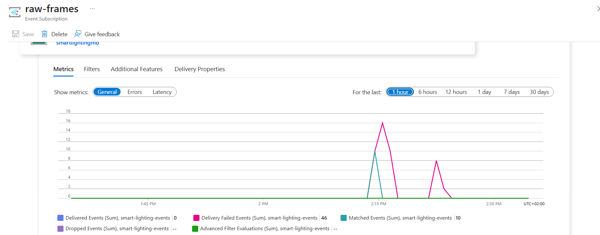

*Figure: Event Grid metrics during the permission problem: events matched the filter, but
every delivery failed until the identity's roles were fixed.*

### Task 3.6 — Performance

**Test conditions.** 18 October 2026, 15:29–15:31 (daylight). One camera, one frame every 0.5 s,
240 frames attempted (2 camera reads failed). Laptop in Spain, all Azure resources in France
Central. Data: `sent.csv` (laptop: upload duration and size) and `counts.csv` (function:
AI Vision time and latency).

| Metric | Mean / median / p95 |
|---|---|
| Frames processed | 238 of 238 uploaded |
| Upload time, laptop → Storage (ms) | 54 / 52 / 67 |
| AI Vision call (ms) | 285 / 287 / 403 |
| Latency, frame stored → result stored (ms) | 1,300 / 1,250 / 1,737 |
| Upload size | 153 kB per frame (2.3 Mbit/s at 2 frames/s) |

**What the times show.** About 1.3 s pass between a frame arriving in Storage and its result
being stored: the Event Grid notification, reading the blob, the AI Vision call (≈ 0.3 s), and
writing three blobs. Each step is a network call between services. The end-to-end time from
the laptop is ≈ 1.35 s (upload + latency): more than the VM's ≈ 0.6 s, but well within the
5 s between two frames of a camera. The function instances were already warm; a cold start
of a scaled-to-zero app adds a few seconds to the first frame.

**Detection effectiveness.** Detection confidence is not accuracy, so we measured it against
a manual count. From the frames uploaded in Part 3 we took the 26 distinct, complete images,
ran **both detectors on the same images** (`python -m smart_lighting.compare`: YOLOv8 at
1280 px, as on the VM, and Azure AI Vision, as in the function), and counted the people by eye
in an evenly spread sample of 12 frames (`runs/compare/ground-truth.csv`).

| 12 frames, 9 people | YOLOv8n (VM) | Azure AI Vision (serverless) |
|---|---|---|
| People found (recall) | 5 of 9 (**56 %**) | 8 of 9 (**89 %**) |
| False detections | **0** | 3 (always the same flower planter) |
| Precision | **100 %** | 73 % |
| Frames with the exact count | 8 of 12 | 10 of 12 |
| Mean absolute count error | 0.33 people | 0.17 people |
| Frames with people where nobody was detected | 2 of 5 | **0 of 5** |

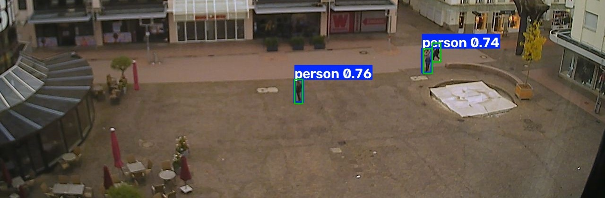

*Figure: the same frame seen by both detectors (blue: YOLOv8, green: Azure AI). YOLOv8
merges the two people walking side by side into one; Azure AI separates them.*

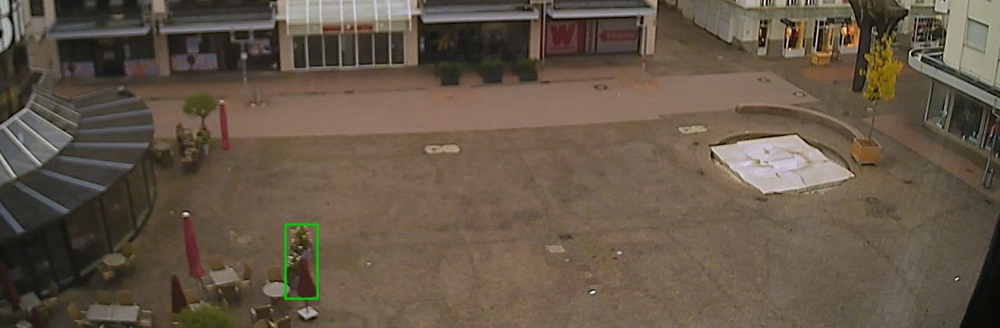

*Figure: Azure AI's recurring false detection: the flower planter with a folded red umbrella.*

YOLOv8n never reported a person that was not there, but it missed almost half of the people,
mostly small, distant or partly hidden ones (Task 1.2 showed it misses even more at 640 px).
Azure AI found nearly everyone but repeatedly took one static object for a person. **For a
lighting controller, a missed person is worse than a false one**: a missed person means
walking in the dark, while a false one only wastes some energy. Azure AI never missed a frame
with people in it, and its static false positive could be removed by ignoring a fixed area or
detections that never move. The sample is small (12 frames, 9 people, one cloudy afternoon),
so these figures indicate a tendency rather than precise rates.

**Cost** (list prices; per frame):

| Item | Price | Per frame |
|---|---|---|
| AI Vision S1, Image Analysis | ≈ $1 per 1,000 images (first 5,000 free for students) | ≈ $0.001 |
| Function (Flex Consumption) | per GB-second of execution; 100,000 GB-s/month free | ≈ 0.6 GB-s, within the free grant |
| Storage + Event Grid | per operation (~5 per frame) and per GB stored | < $0.00001 |

**AI Vision dominates: about $0.001 per frame.** One camera at one frame every 5 s costs
≈ $0.72 per hour, and at 0.5 s ≈ $7 per hour. Compared with the VM (≈ $0.019 per hour for up
to 16 cameras), serverless + Azure AI is far more expensive *per frame*. However, it costs
nothing when no frames arrive and needs no capacity planning: we pay exactly for the work
done.

## 5. Part 4: Multi-camera management

### Task 4.1 — Increasing the number of cameras

A real SLS covers an area with many cameras. To find out how many each architecture can serve,
we increased the number of cameras step by step: **1, 2, 4, 8, 12, 16, 24 and 32**, each
sending **one frame every 5 seconds**, for **2 minutes per step**, with a 30-second pause
between steps so that one step's backlog does not spill into the next.

Public webcams with a direct image URL, a fixed view and pedestrians are rare (Task 1.1), and
32 of them would not all be online and in daylight at the same time. We therefore simulated
the cameras with `loadtest.py`:

- one thread per simulated camera, each with its own name (`n08-c03` = camera 3 of the
  8-camera step), so every result can be traced to its step;
- the real Gaggenau camera is read once every 5 s and **every simulated camera sends that
  real, current frame**. The cloud therefore receives exactly the traffic of N real cameras:
  N real 1280 × 720 frames (≈ 165 kB each) every 5 s. The public camera's server, however,
  still receives only one request every 5 s;
- the cameras are **spread evenly over the 5 s** (camera *i* starts at *i* × 5/N s), as
  independent real cameras would be, rather than all sending at the same instant;
- each simulated camera uses the same code path as a real one (`camera.capture` →
  `streaming.stream` → target), so the measurements include JPEG encoding and upload.

The same tool sends to the VM (`--target vm`) and to Blob Storage (`--target blob`), so both
architectures are tested under identical conditions.

### Task 4.2 — Processing limit of the VM

**Test conditions.** 17 October 2026, 14:17–14:50, daylight. VM Standard_B2ats_v2 (2 vCPU,
1 GiB) in Austria East, YOLOv8n at 1280 px; laptop in Spain. Data: `sent.csv` (laptop) and
`resources.csv` (VM, every 5 s), summarised with `python -m smart_lighting.analysis load`.

| Cameras | Delivered | Frames/s | Response ms (median / p95) | Inference ms (median) | CPU % (median) | Memory % (median) | Upload kbit/s |
|---|---|---|---|---|---|---|---|
| 1 | 100 % | 0.2 | 638 / 965 | 292 | 3 | 69 | 269 |
| 2 | 100 % | 0.4 | 448 / 662 | 299 | 6 | 69 | 486 |
| 4 | 100 % | 0.8 | 637 / 749 | 299 | 12 | 70 | 1,068 |
| 8 | 100 % | 1.6 | 596 / 685 | 282 | 24 | 75 | 2,127 |
| 12 | 100 % | 2.4 | 452 / 623 | 293 | 37 | 72 | 3,065 |
| **16** | **100 %** | **3.2** | **600 / 682** | **292** | **49** | **79** | **4,252** |
| 24 | 14 % | 0.7 | 27,208 / 48,261 | 934 | 23 | 90 | 864 |
| 32 | 2 % | 0.1 | 27,428 / 58,676 | 1,191 | 15 | 79 | 144 |

*Delivered = frames answered by the VM ÷ frames the cameras should have sent. The service
memory is not shown; it stayed between 320 and 600 MB.*

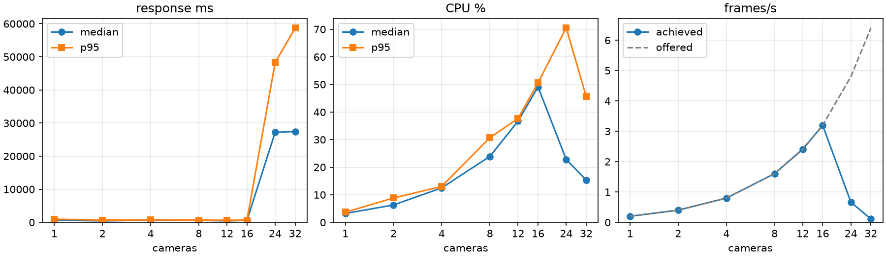

*Figure: VM response time, CPU and throughput vs number of cameras (logarithmic axis).
Throughput follows the offered load (dashed) up to 16 cameras and then collapses.*

**The limit is 16 cameras.** Up to 16 cameras every frame was answered in about 0.6 s, and the
response time did not grow with the load. At 24 cameras the system collapsed: only 14 % of
the frames got an answer, after 27 s on average.

**Why exactly there.** The VM runs one inference at a time, and one inference takes
0.29 s. The most it can process is therefore 1 / 0.29 ≈ 3.4 frames/s, which is
3.4 × 5 ≈ **17 cameras**. With 16 cameras (3.2 frames/s) the detector is busy 94 % of the
time but keeps up. With 24 cameras (4.8 frames/s) more frames arrive than leave:

1. requests wait in a queue on the VM, so response time rises above the 5 s interval;
2. each waiting request holds its image in memory. The 1 GiB fills up (90–97 %), and Linux
   moves memory to the swap file on disk;
3. now the model itself must be read back from disk, so **inference becomes 3–30× slower**
   (0.9–8.6 s), which makes the queue grow even faster: a downward spiral;
4. **CPU usage falls** (from 49 % to 23 %) while the system is overloaded: the CPU is
   waiting for the disk. CPU alone would wrongly suggest the VM has capacity to spare.

The CPU never reached 100 % before the limit. With 2 vCPUs and inferences run one at a time,
the model's speed sets the limit, and memory turns overload into collapse. The service did
not crash: after the test it was still running and had never been restarted (`NRestarts=0`). The VM is thus a fixed-capacity system. To serve more cameras one must buy a larger
VM or more VMs (*scale up / scale out*), or make inference cheaper, e.g. at 640 px at the cost
of missed people (Task 1.2).

**A confounding event.** At 14:34, during the 24-camera step, Ubuntu's automatic security
updates (`unattended-upgrades`) downloaded ≈ 200 MB (a 313 Mbit/s burst in our log, also
visible in Azure Monitor) and installed 55 packages until 14:48. This competed for the same
scarce memory and disk. The capacity limit itself (≈ 17 cameras) follows from the inference
time and holds regardless, but the update made the collapse at 24 cameras worse. We did not repeat the
step without the update, so the exact collapse point between 16 and 24 cameras is not
measured. A production VM should schedule such updates
outside operating hours.

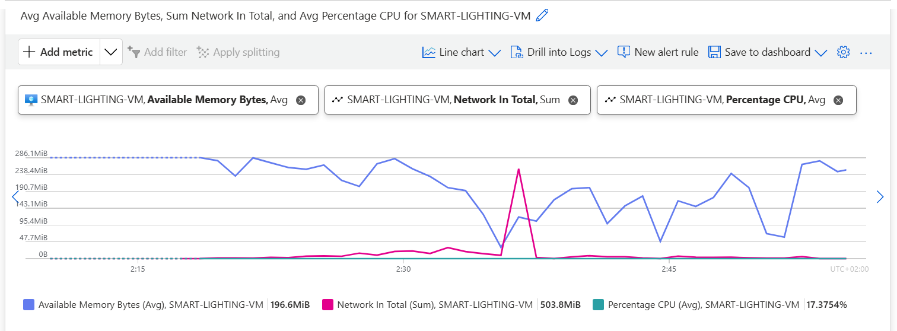

*Figure: Azure Monitor during the load test (14:10–14:55). Available memory falls from
≈ 280 MiB to almost zero once the load exceeds the VM's capacity (from ≈ 14:33); the network
peak at ≈ 14:35 is the Ubuntu update download.*

**Bandwidth.** Each camera uploads about 270 kbit/s; 16 cameras need 4.3 Mbit/s into the VM.
The VM's network is far from its limit, and data into Azure is free.

**Cost per camera.** The VM costs the same whether it serves 1 or 16 cameras: ≈ $0.019/h list
price (Task 2.5), i.e. **≈ $0.0012 per camera-hour at 16 cameras**, 16 times less than with one
camera. A VM is cheapest when it runs close to its capacity, but it cannot absorb peaks.

### Task 4.3 — Processing limit of the serverless application

**Test conditions.** 18 October 2026, 15:32–15:55, daylight. The same load tool and steps
(1, 4, 16, 32, 48, 64, 96 and 128 cameras, 2 minutes each, one frame per camera every 5 s) with
`--target blob`. Data: `sent.csv` (laptop: upload duration and size) and the function's
`counts.csv` (one row per processed frame, with its latency). A frame counts as processed
once its result is stored in `$web`.

| Cameras | Frames/s | Processed | Upload ms (median) | Latency ms (median / p95) | Upload Mbit/s |
|---|---|---|---|---|---|
| 1 | 0.2 | 100 % | 52 | 1,306 / 1,529 | 0.3 |
| 4 | 0.8 | 100 % | 57 | 1,280 / 1,702 | 1.0 |
| 16 | 3.2 | 100 % | 51 | 1,115 / 1,667 | 4.0 |
| 32 | 6.4 | 100 % | 50 | 1,159 / 1,674 | 8.3 |
| 48 | 9.6 | 100 % | 51 | 1,146 / 1,690 | 12.4 |
| 64 | 12.8 | 100 % | 50 | 1,184 / 1,766 | 14.8 |
| 96 | 19.2 | 100 % | 49 | 3,049 / 6,212 | 21.2 |
| **128** | **25.6** | **99.97 %** | 54 | **5,641 / 12,764** | 31.9 |

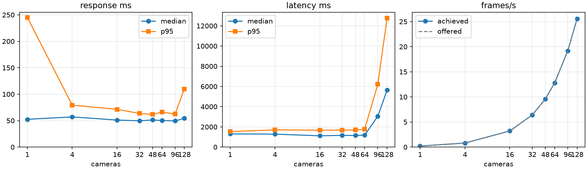

*Figure: serverless upload time, latency and throughput vs number of cameras. Throughput
always equals the offered load; latency is flat up to 64 cameras and grows from 96.*

**Practically every frame was processed at every level**: 9,335 of 9,336 (one frame of the
128-camera step was missing when we collected the results). Up to 64 cameras the latency did not change at all (≈ 1.2 s): Flex
Consumption started more function instances as frames arrived, so each frame was processed
in parallel with the others instead of waiting in line. This is the serverless promise of
automatic scale-out, and it is visible in the flat line.

**The limit is about 96–128 cameras.** At 96 cameras the median latency rose to 3 s, and at
128 cameras to 5.6 s (p95 12.8 s): a camera's result then arrives after its next frame, and
work queues up. We define that as the processing limit for a lighting controller. Unlike
the VM, the system did not collapse: frames waited and were all eventually processed. What
saturates is outside our code: the rate at which AI Vision S1 accepts requests (the SDK
retries throttled calls automatically, which adds delay) and the speed at which Flex
Consumption adds instances. Both limits can be raised (a higher AI quota, more maximum
instances) without changing the code. The laptop was not the bottleneck: uploads stayed at
≈ 50 ms even at 32 Mbit/s.

**Cost at the limit.** At 128 cameras (25.6 frames/s) AI Vision costs about $92 per hour at list
price, against ≈ $0.019 per hour for the VM. The load test itself used ≈ 9,000 images.

### Comparison of the two architectures

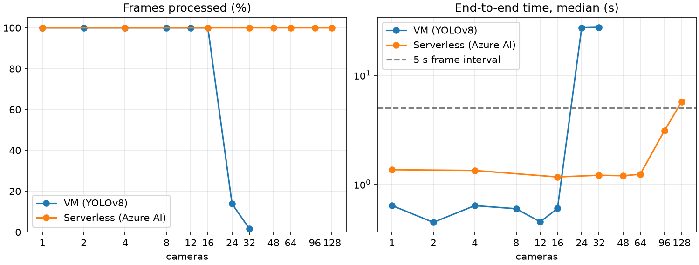

*Figure: frames processed and median end-to-end time (upload + processing) vs number of
cameras, for both architectures. The dashed line is the 5 s between two frames of a camera.*

| | VM (Part 2) | Serverless + Azure AI (Part 3) |
|---|---|---|
| End-to-end time per frame | **≈ 0.6 s** | ≈ 1.2–1.4 s |
| Processing limit | **16 cameras**, then collapse (14 % processed at 24) | **≈ 96–128 cameras**, then slower but nothing lost |
| Behaviour under overload | queue → memory → swap → slower inference → collapse | queue → higher latency, eventually processed |
| Scaling | manual: a bigger VM or more VMs | automatic scale-out |
| Detection (Task 3.6) | 56 % of people found, no false detections | 89 % found, some static false detections |
| Cost | fixed ≈ $0.019 / h, any load | ≈ $0.001 per frame (≈ $0.72 per camera-hour) |
| Cost when idle | same as under load | nothing |
| Operation | we patch the OS, manage memory, open ports | none: the platform runs it |

The two architectures trade **cost** against **elasticity**. For a fixed, known number of
cameras that fits one machine, the VM is much faster and cheaper per frame. The serverless
design costs about 40 times more per camera at full load, but scales on its own to ~6 times
as many cameras, never drops frames, and costs nothing at night when cameras send nothing.
In a real SLS the deciding factors would be the number of cameras and how variable the load
is.

## 6. Advanced work

We chose the improvements our measurements pointed to: the serverless design pays per image
and uploads full frames, so **sending fewer and smaller images** saves money and bandwidth
directly (advanced item 3). We also investigated **counting each person once** (item 1).
Item 2 (vehicles) was not done: the camera overlooks a pedestrian zone with no traffic to
count. The detector would only need the COCO vehicle classes added to `classes=`.

### 6.1 Motion detection on the laptop: send only frames that changed

**Idea.** The camera publishes a new image only every 5 s, so at Part 3's 0.5 s rate nine of
ten uploads repeat the last image. Even after a refresh, an empty square looks the same. A
frame in which nothing changed cannot change the people count, so it need not be sent: the
controller keeps the last count.

**Method.** `camera.ChangeFilter` compares each frame with the last frame sent, on small
(320 × 180) blurred grey copies. A pixel counts as changed if its brightness moved by more
than 25 levels (of 255), and the frame is sent if at least **20 pixels** changed. We chose
the threshold from the Part 3 frames: 203 of 233 consecutive pairs changed by 0 pixels (no
camera refresh), a refresh with only camera noise changed 4–13 pixels, and a walking person
changed 60–540. A **heartbeat** sends at least one frame per minute anyway, so an error,
for example a person standing perfectly still, can never last long. The filter is enabled
with `uploader.py --only-changes`.

**Results.**

| Test | Frames captured | Sent | Skipped | Count errors |
|---|---|---|---|---|
| Replay of the Part 3 run (234 complete frames, YOLOv8 on every frame) | 234 | 27 | 207 (88 %) | **0**: every skipped frame had the same count as the last frame sent |
| Live run, 18 Oct 16:30, 2 min at 0.5 s, to Azure | 231 | 13 | 218 (94 %) | (not measurable live) |

The filter cut uploads, function executions and **AI Vision calls by 88–94 %** with no loss
of information; at ≈ $0.001 per image this is the same saving in money. The saving depends
on the scene: at the 5 s rate during busy hours almost every frame changes, while at night
or on an empty square nearly all frames are skipped, which is exactly when an SLS needs no
processing.

### 6.2 Minimum resolution and compression that keep detection quality

**Method.** `python -m smart_lighting.compare --sweep` re-sends the 12 hand-counted frames
(Task 3.6) at 3 widths (1280, 960, 640 px) × 3 JPEG qualities (90, 70, 50) to both detectors
and records the upload size and the people found (count-based: per frame, at most the true
number of people counts as found).

| Width / quality | kB per frame | YOLOv8 found | Azure AI found | Azure extra detections |
|---|---|---|---|---|
| 1280 / 90 (Parts 2–4) | 156 | 56 % | 100 % | 2 |
| 1280 / 70 | 104 | 44 % | 89 % | 1 |
| 960 / 90 | 107 | 44 % | 100 % | 2 |
| **960 / 70** | **56** | 44 % | **89 %** | **0** |
| 960 / 50 | 41 | 56 % | 100 % | 4 |
| 640 / 90 | 57 | 44 % | 89 % | 1 |
| 640 / 70 | 30 | 33 % | 78 % | 1 |
| 640 / 50 | 22 | 33 % | 56 % | 2 |

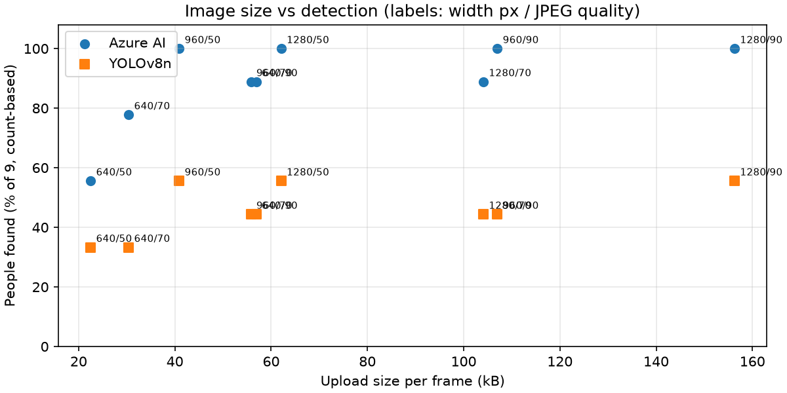

*Figure: upload size vs people found for both detectors (labels: width / JPEG quality).*

Down to about 40–60 kB per frame, detection does not change beyond ±1 person in the sample;
at 640 px with quality ≤ 70 both detectors lose people (Azure AI 56–78 %, YOLOv8 33 %), and
strong compression (quality 50) adds false detections. **960 px at quality 70 is the best
compromise: 56 kB instead of 156 kB (−64 % bandwidth and storage) with the same detection.**
With only 9 people in 12 frames, differences of one person (11 %) are within noise; the
trend at the low end is the reliable result.

**Combined effect.** With 960/70 images and the change filter, a camera at 0.5 s needs
≈ 6–13 kB/s instead of 306 kB/s on our data (−96 to −98 %), and the AI cost falls by the same 88–94 %
as the uploads.

### 6.3 Counting each person once: tracking

**Idea.** Summing the per-frame counts counts the same person in every frame in which they
appear. To count people *passing by*, detections must be linked across frames into one
track per person. Ultralytics includes the **ByteTrack** tracker (`model.track(persist=True)`),
which gives every person a stable ID; the number of distinct IDs is the number of people who
passed.

**Why not on our camera.** Linking works if a person moves only a little between two frames.
Our camera gives one image every 5 s, in which a pedestrian walks ≈ 7 m: there is nothing to
link. We therefore tested tracking (`python -m smart_lighting.tracking`) on OpenCV's recorded
pedestrian video `vtest.avi` (795 frames at 10 frames/s, 80 s), and repeated it at lower frame
rates to measure how much frame rate tracking needs:

| Frames per second used | Frames | Unique people (track IDs) |
|---|---|---|
| **10 (full video)** | 795 | **35** |
| 5 | 398 | 48 |
| 2 | 159 | 36 |
| 1 | 80 | 15 |
| 0.2 (our camera's rate) | 16 | 3 |

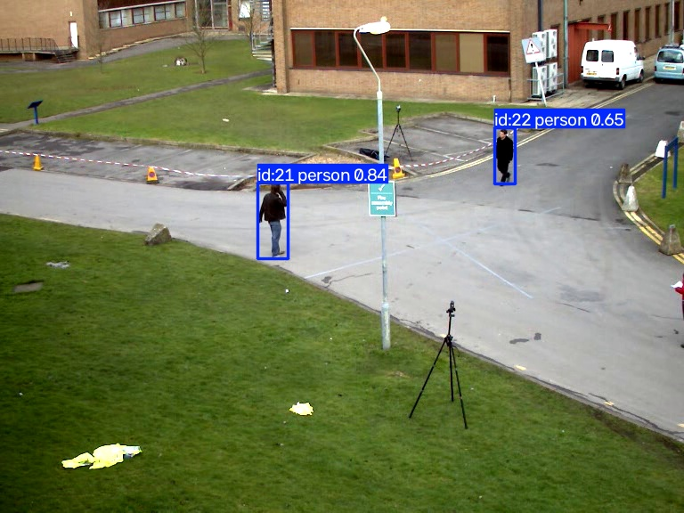

*Figure: ByteTrack on the recorded video; each person keeps an ID (21, 22) across frames.*

At 10 frames/s YOLOv8 makes 4,341 person detections in the 795 frames, which the tracker
links to **35 people**: summing per-frame counts would count each person ≈ 124 times. At
lower rates the result becomes unreliable: at 5 frames/s people get new IDs after small jumps
(48), at 1 frame/s and below tracks are never confirmed (15, then 3). The 35 at full rate is
an estimate: we did not verify every track by hand, and crowded crossings can still swap IDs.

**Conclusion.** Counting unique people needs **a video stream of at least ≈ 5–10 frames per
second**, not a still image every 5 s. That much video is best processed close to the camera
(an edge device or the local machine), sending only counts to the cloud: at 10 frames/s a
1280 × 720 stream would mean 50 times more frames per camera than the one frame every 5 s our cloud designs were sized for. The
capture code already reads MJPEG/HLS streams, so the system can use such a camera directly.

## 7. Conclusions

We built one people-counting pipeline for a Smart Lighting System and ran it on three
infrastructures: a laptop, an Azure virtual machine, and a serverless design with Azure AI.
The same capture code, the same 5-second cadence and the same CSV format were used
throughout, so the measurements are directly comparable. The work supports these conclusions:

1. **The input matters as much as the model.** On a wide camera view YOLOv8 at its default
   640 px found only 2 of 8 people; at the camera's native 1280 px it found 7. A camera that
   rewrites its image while it is being downloaded silently delivered truncated frames (≈ 5 %
   at 5 s, more at 0.5 s), and a laptop clock 10 s fast made a naive latency measurement
   negative. All three were found by inspecting the data, not by the code failing, and are
   now handled in the code.
2. **The VM is fast and cheap but has a hard limit.** With one camera a frame was answered in
   ≈ 0.6 s at ≈ 3 % CPU. The limit, 16 cameras, matches the inference time
   (1 / 0.29 s ≈ 3.4 frames/s ≈ 17 cameras). Beyond it the 1 GiB of memory, not the CPU, turned
   overload into collapse: queued frames forced the model into swap and inference became up
   to 30 times slower. Memory-limited machines need back-pressure, i.e. rejecting excess work,
   rather than an unbounded queue.
3. **Serverless trades cost for elasticity.** The function scaled out by itself: up to
   64 cameras its latency stayed at ≈ 1.2 s, and even at 128 cameras practically every frame
   was processed, only later. Each frame, however, passes through several services (≈ 1.3 s
   in total), and Azure AI costs ≈ $0.001 per image, about 40 times more per camera than the
   VM at full load. In return it costs nothing when no frames arrive and needs no operating
   system, patching or capacity planning.
4. **The managed AI service detected people better, but not perfectly.** On the same images
   Azure AI found 89 % of the people against YOLOv8n's 56 %, at the price of a recurring false
   detection of a static object. For lighting, where missing a person is worse than a false
   alarm, Azure AI's behaviour is preferable; YOLOv8n would need a larger model or a closer
   camera.
5. **Cloud configuration is the hard part of serverless.** The function is about
   100 lines; making it run required regions allowed by the subscription, managed identities,
   five role assignments, Event Grid filtering and webhook keys. Each misconfiguration failed
   silently (no invocations at all), and was diagnosed from platform metrics and logs. Keys
   were kept out of the code throughout, and three independent filters prevent the
   recursive triggering the assignment warns about.

6. **Sending less data is the cheapest optimisation.** Skipping unchanged frames on the
   laptop removed 88–94 % of the uploads and AI calls without changing any count, and 960 px
   images at JPEG quality 70 cut each upload by 64 % with the same detection. Counting each
   person once, by tracking, works on video at 10 frames/s, but needs far more frames than a
   still image every 5 s, which argues for processing such video near the camera.

For a real SLS, a VM (or a few) suits a known, stable number of cameras; the serverless
design suits a large or highly variable number of cameras, or night-time operation where most
frames never need processing, provided the per-image cost is acceptable.

## References

1. Teaching team: *Practice 1: Cloud Computing Services*, its assessment criteria, the Azure
   documentation 1–3 (serverless model, HPC/AI services, Functions with Blob Storage and
   Event Grid) and the sample code `contador_personas`.
2. Ultralytics YOLOv8 and tracking: <https://docs.ultralytics.com/models/yolov8/>,
   <https://docs.ultralytics.com/modes/track/>
3. Microsoft Azure documentation: static websites in Blob Storage, Flex Consumption plan,
   event-based blob trigger, identity-based connections, Image Analysis 4.0 people detection
   and pricing: <https://learn.microsoft.com/azure/>
4. City of Gaggenau webcam: <https://www.gaggenau.de/webcams.212.htm>
5. OpenCV `vtest.avi` sample video: <https://github.com/opencv/opencv/tree/4.x/samples/data>

**Source code.** All code, the VM setup script, the Azure guides and the analysis tools are in
the project repository, <https://github.com/botezatumarius/azure-smart-lighting> (`src/smart_lighting`, `functions`, `deploy`, `docs`). The README explains
how to reproduce every measurement.
